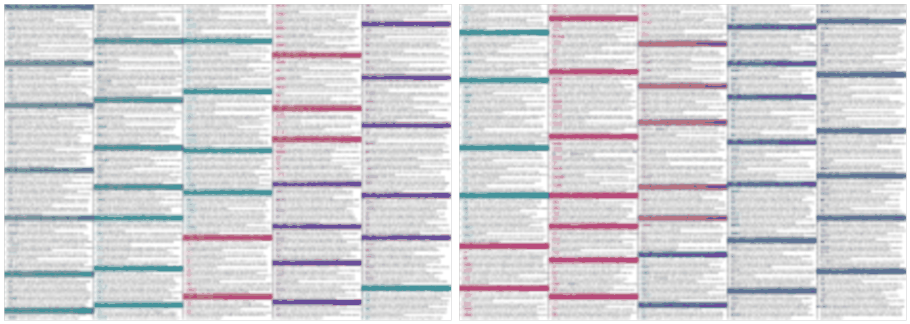
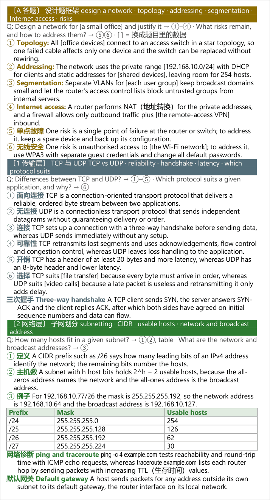

# answer-card-cheatsheet

A Claude Code skill that builds a dense, colour-coded, exactly-two-page A4 exam cheatsheet in the "答题卡" (answer-card) format: every likely exam question gets a card of numbered, copy-ready English sentences with Chinese search tags, laid out in 5 newspaper columns from a Markdown master.

一个 Claude Code skill：按「答题卡」格式做考试 cheatsheet（A4 横向、正好两页、5 栏、按主题配色）。每张卡对应一道可能的考题，配可以直接抄进试卷的英文句子和方便查找的中文标签。

**Used at the University of Sydney.** Cheatsheets made with this skill were used in the final exams of two postgraduate IT units at the University of Sydney (restricted open book, one double-sided A4 sheet). In both exams the cards were found from the questions' English keywords, and the answers were copied with only the words in `[ ]` changed.

**在悉尼大学实际用过。** 用这个 skill 做的答题卡，在悉尼大学（The University of Sydney）两门研究生 IT 课的期末考试中实际使用（限定开卷，可带一张 A4 双面）。两次考试都能按题目里的英文关键词找到卡片，答案整句抄，只换 `[ ]` 里的词。

<sub>This is a personal project, not affiliated with or endorsed by the University of Sydney. 本项目是个人作品，与悉尼大学没有官方关系。</sub>

<p align="center"></p>
<p align="center"><sub>Both sides of a real sheet used in one of those exams (66 cards), pixelated so that no text can be read.<br>其中一场考试实际用的答题卡两面（66 张卡），已打码，文字无法辨认。</sub></p>

<p align="center"></p>
<p align="center"><sub>One column of the made-up example (<code>assets/example.md</code>) at the default 4.5 pt, enlarged. A full sheet has five such columns on each side of an A4 page.<br>虚构示例的一栏（默认 4.5 pt，已放大）。整张表每面 5 栏。</sub></p>

## 合规使用 · Use it within your exam's rules

- 只用于允许带 cheatsheet 的考试。先看清自己考试的规定：能带几张、多大、单面还是双面、能不能打印。
- 卡片上的句子要根据你自己的课程材料改写。skill 会按这个要求写，不照抄课件和考题原文；考前你也要把每句读一遍，确认都看得懂。
- 用课程材料做出来的表只给自己用，不要公开上传或分享：课件、模拟卷和评分指南的版权属于学校和任课老师。这个仓库里只有虚构的示例。

Use it only for exams that allow a cheatsheet, and check your own exam's rules first (how many sheets, what size, one or both sides, printed or not). The sentences are paraphrased from your own course materials, not copied from slides or exam papers; read every one before the exam. Keep sheets made from course materials to yourself: slides, mock exams and marking guides belong to the university and the teaching staff. This repository holds only made-up examples.

## 开始前你需要 · Requirements

| 需要 | 用途 | 怎么装 |
|---|---|---|
| [Claude Code](https://claude.com/claude-code)，以及能用它的 Claude 付费订阅或 API 账号 | 运行这个 skill | 见官网 |
| Windows + Microsoft Word | 把 `.docx` 导出成 PDF（`scripts/export_pdf.ps1`）；排版是在 Windows 版 Word 上测出来的 | — |
| Python 3，加 `python-docx` 和 `PyMuPDF` | 构建和测量 | `pip install python-docx pymupdf` |
| pandoc 2.x 或更新 | Markdown 转 Word | `winget install --id JohnMacFarlane.Pandoc`；装过 RStudio 或 Quarto 的话会自动用它们自带的那份，也可以用环境变量 `PANDOC` 指定路径 |
| Chrome 或 Edge | 只在把讲义等配套文档转成 PDF 时用（`scripts/md_to_pdf.py`） | — |

- 不会装也没关系：装好 Claude Code 后，可以直接让它检查并安装其余几项。
- Mac 没有测试过：可以先生成 `.docx`，用 Mac 版 Word 另存为 PDF，再用 `measure_layout.py` 量页数。断行和字距可能和 Windows 版不同，一定先打印一份确认。

In short: Claude Code (with a paid Claude plan or an API account), Windows with Microsoft Word for the PDF export, Python 3 with `python-docx` and `PyMuPDF`, pandoc 2.x or newer, and Chrome or Edge for the companion documents only. macOS is untested: build the `.docx`, save it as PDF from Word for Mac, measure it, and print one copy to check.

## Install

Copy this folder to your personal skills directory, then start a new Claude Code session:

```bash
git clone https://github.com/shuxiachai/answer-card-cheatsheet.git ~/.claude/skills/answer-card-cheatsheet
```

On Windows the directory is `C:\Users\<you>\.claude\skills\answer-card-cheatsheet`.

Then ask Claude Code something like "帮我做一份这门课的 cheatsheet" or "make an exam cheatsheet in the answer-card format".

## 使用方法

适合「限定开卷、只能带一张 A4 双面」的考试：把可能考的题做成答题卡，考场上找到卡就能整句抄英文答案。

1. **准备资料**（放进项目文件夹，或告诉 Claude 在哪里）
   - 考试规则：几张纸、单面还是双面、题型和分值。
   - 复习课、官方模拟卷和答案或评分指南、题库：最重要，卡片句子尽量用评分指南里的关键词。
   - 各周课件（特别是 Summary 页）、tutorial、quiz。
   - 同学的 cheatsheet 只用来查漏，不照抄。
   - 说清哪些练习题属于这场考试。别的考核（比如口试、平时测验）的题库不要给，或者明确说不用；Claude 会把不用的资料记在母版开头。
2. **说清要求**，例如「只用来答场景题，选择题我另外背」「不要留白」。可以直接用下面的[第一条消息模板](#第一条消息模板)。
3. **Claude 会做的**
   - 每道可能的考题一张答题卡：标题是中文名加题目里会出现的英文关键词；Q 行写问法和要抄第几条；每条要点是一句完整的英文，约 1 分。
   - 要按题目换的词放在 `[ ]` 里；生僻缩写后面可以加（中文注），抄的时候跳过。
   - 排成 A4 横向 5 栏、正好两页，生成 `.md`（母版）、`.docx` 和 `.pdf`。
4. **你要检查的**
   - 每句能不能直接抄，有没有看不懂的缩写。
   - 拿官方模拟卷和题库演练一遍：每个小问都能在表上找到要抄的句子，找不到的让 Claude 补。Claude 会用 `rehearse.py` 只拿表上的原句、只换 `[ ]` 里的词拼出每个小问的答案，并检查题目里的英文词能不能在卡片标题里找到、Q 行有没有指到要抄的条目。
   - 题库对完以后，还可以让 Claude 拿课件和 tutorial 里的讨论题再查一遍覆盖面。
   - 想多练可以让 Claude 出模拟卷和答案：答案标出每句抄自哪张卡（【原样】【换槽】【题干句】【自写一句】）。选择题不放在表上时，可以另做一份选择题讲义，考前背熟。
   - 想确认表上的内容都出自课程（比如同学说有课本里没有的内容）：让 Claude 做出处核对，它会列出课程文件里找不到的词和句子，查得到的给出文件和页码。
   - 改内容时让 Claude 改 `.md`，不要直接改 `.docx`。
5. **打印**：打印 PDF（版面固定），不要换一台电脑重新打开 `.docx` 再打。默认 4.5 pt，标题和序号不加粗，两次实际考试中打印出来都看得清；先打一份确认，看不清就改成 5 pt。
6. **考场上**：读题 → 用题目里的英文关键词找卡片标题 → 看 Q 行指向第几条 → 整句抄，只换 `[ ]` 里的词，（）里的中文注不抄。一道题跨好几个主题时按小问分别找卡；遇到 compare / prioritise / evaluate，在原句后面补一句自己的话，点明比较、先后或结论。

### 第一条消息模板

复制下面这段，换掉 `<>` 里的内容。「要求」几行是一组示例选择，按自己的考试删改；做过一份的话，把上一份 `.md` 给 Claude 当格式范例。

```
/answer-card-cheatsheet
帮我给 <课程代码 课程名> 做一份答题卡式 cheatsheet。（可选）格式参照上一份：<上一份 .md 的路径>

考试：<日期>，<题型和分值，例如 10 道选择题 + 4 道场景题 × 10 分>，限定开卷，可带一张 A4 纸双面。
资料：
- 复习课：<路径>
- 官方模拟卷和答案/评分指南：<路径>
- 题库：<路径>
- 各周课件：<路径>
- 同学的 cheatsheet（只用来查漏，不照抄）：<路径>
- 不用的资料（例如别的考核的题库）：<路径或名称>

要求：
- 表上只放大题（场景题）的内容；选择题另做一份复习讲义，中英穿插讲，例题纯英文
- 不留白，卡片可以跨 A/B 面
- 不要通用的答题方法卡；卡片标题写中文名 + 题目里会出现的英文关键词
- 生僻缩写后面加中文注，只加在不占行的地方
- 字号 4.5 pt
- 做完后用官方模拟卷和题库逐个小问检查能不能直接抄，把缺口列给我
```

之后可以分几次发：

1. 「新的官方模拟卷出来了，和表对一遍，补缺口」
2. 「出一套模拟卷和答案，答案标出每句抄自哪张卡、在第几面第几栏」
3. 「表改过了，把演练和答案里的卡片位置更新一下」
4. 「做选择题复习讲义，转成 PDF」
5. 「给生僻缩写加中文注」
6. 「同学说表上有课本里没有的内容，核对一遍出处」
7. 考后：「把这次的经验整理进 skill」

小提示：

- 在新课程的文件夹里打开会话，资料路径可以写相对路径。
- 题型不同就改「要求」几行，例如全是选择题、或者选择题也要放进表里，就删掉「表上只放大题」那一行。
- 开头的 `/answer-card-cheatsheet` 可以不写，提到 cheatsheet 或「答题卡」一般会自动加载这个 skill；写上能确保加载。
- 每次都一样的要求可以写进 `~/.claude/CLAUDE.md`（Windows：`C:\Users\<you>\.claude\CLAUDE.md`），所有会话都会读到，prompt 里就不用重复。

## Contents

| Path | What it is |
|---|---|
| `SKILL.md` | Workflow: collect exam signals, tier the content, write the master, build, fit to two pages, verify, rehearse with a mock exam |
| `references/format.md` | Exact Markdown syntax of every block, writing rules per question type, colour palette, layout spec |
| `references/fitting.md` | How to land on two pages: column-bottom gaps, measured compression ladder, too little content, trimming, pitfalls |
| `references/companions.md` | Optional practice paper and answer key (every sentence labelled by how it was made), MCQ handout, review handout |
| `scripts/check_master.py` | Checks the master before building (colours, Q-line references, numbering, tags, lengths, figures) and every copyable sentence (Chinese, It/This openings, source words, past tense that narrates one case, exam-technique words, slot length), and points no Q line points to; counts sentences with and without `[slots]`; `--similar` lists near-duplicate sentences |
| `scripts/build_cheatsheet.py` | Markdown master → `.docx` (`python build_cheatsheet.py sheet.md [out.docx] [font_pt=4.5] [margin_cm=0] [gap_cm=0.1] [--keep-with-next] [--bold-titles]`); a column may end with a card's title or Q line unless `--keep-with-next` is given; titles and Q lines may break after ` · `, and `→` stays with its point numbers; figures via `` |
| `scripts/export_pdf.ps1` | Word export of the `.docx` to PDF (relative or absolute paths); uses Microsoft Print to PDF for its own Word session so small text is evenly spaced |
| `scripts/measure_layout.py` | Page count, spare lines, uneven letter spacing, column-bottom gaps, columns that end with a card title or Q line, title line counts and wrapped Q lines, short last lines, where given text sits, and with `--cards sheet.md` where every card starts, which `--update doc.md` writes into documents that cite card positions (font size and margin detected from the PDF) |
| `scripts/rehearse.py` | Answers every sub-question of a question list with the sheet's own sentences, changing only the `[slots]`; checks cards, points, Q lines and whether the question's words are in the card's title; lists points no question used |
| `scripts/source_audit.py` | Lists sheet sentences that use words found in none of the course files (PDF, PPTX, DOCX, TXT, MD); `--find` gives the file and page of a term |
| `scripts/md_to_pdf.py` | Markdown → PDF for companion documents (pandoc → HTML → Chrome/Edge print) |
| `assets/handout.css` | A4 style for those PDFs |
| `assets/example.md` | A short made-up master (Computer Networks) showing the format |
| `assets/example_rehearsal.md` | A question list for `rehearse.py` that goes with `example.md` |
| `assets/preview.png` | One column of `example.md` as printed, enlarged, for this README |
| `assets/sheet_blurred.png` | Both sides of a real sheet, pixelated, for this README |

## License

[MIT](LICENSE). 脚本和文档按 MIT 许可证发布：可以自由使用、修改和再发布，保留版权声明即可。
